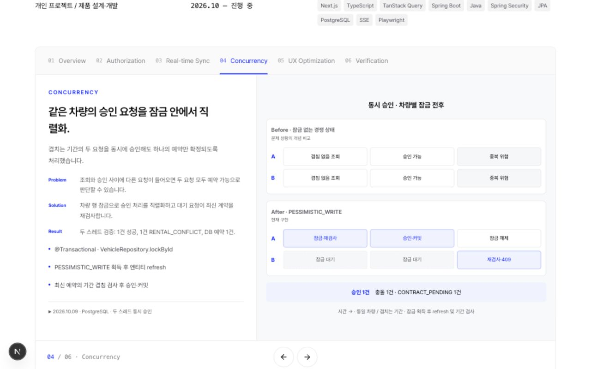
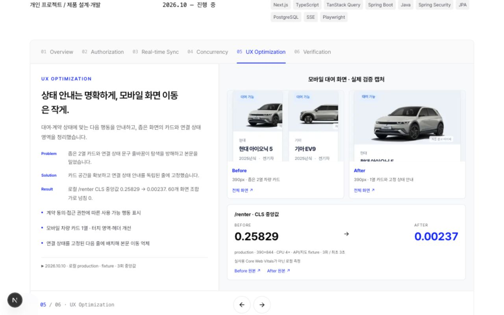

# My Garage 상세 페이지 리뉴얼

프로젝트명·상단 탭·왼쪽 설명/오른쪽 시각 자료·파란색 포인트·하단 이동 버튼을 유지했습니다. My Garage 서비스 코드는 읽기만 했습니다.

| 페이지 | 이전 | 리뉴얼 |
|---|---|---|
| Overview | 세로 계층 박스 | Client/Server 가로 그룹 및 분리된 REST/SSE 요청 경로 |
| Authorization | 5개 세로 박스 | 대여자·Spring 서버·소유자 시퀀스, 권한 실패/성공 구분 |
| Real-time Sync | 6개 세로 박스 | Commit→SSE / Query→REST의 두 줄 가로 흐름 및 복구 분기 |
| Concurrency | 두 열의 세로 체인 | A/B 요청별 가로 시간축, 대기·커밋·재검사 비교 |
| UX Optimization | 캡처 준비 안내 | 실제 UI fixture 캡처 Before/After, CLS 원본 및 실행 조건 |
| Verification | 7개 세로 단계 | 6단계 2열 그룹 및 실행 범위를 구분한 검증 표 |

첫 장은 핵심 구현 4개, 나머지는 짧은 소개 + Problem/Solution/Result + 3개 불렛으로 정리했습니다. 실행 조건은 접을 수 있는 근거 영역에 넣었고, 측정/코드 확인 관련 작업 메모는 화면에서 제거했습니다. 사용하지 않는 기존 My Garage 다이어그램 데이터는 삭제했습니다.

## 근거

실제 소스·검증 문서: `my-garage-source-audit.md`.

페이지에서 접근 가능한 근거: `/projects/my-garage/evidence.md`.

CLS 원본 JSON의 /renter 3개 표본 중앙값을 직접 계산해 `0.25829 → 0.00237`을 확인했습니다. 60개 화면 검사 JSON도 60/60 가로 넘침 없음으로 확인했습니다. 각 회귀 실행 수는 합산하지 않습니다. 서비스 테스트는 이번 리뉴얼에서 재실행하지 않았습니다.

## 시각 검증

1280×800 데스크톱에서 6장 모두 기본 본문·시각 자료의 scrollHeight = clientHeight (576px)로 내부 스크롤 없이 표시됨을 확인했습니다. 근거 상세 펼치기는 추가 내용에 따라 스크롤할 수 있습니다. 모바일 390px에서는 두 영역을 자연 높이로 쌓아 내용 잘림과 중첩 스크롤을 제거했습니다. 320px 권한 시퀀스는 읽을 수 있는 2열 단계로 전환합니다.

## 추가하면 좋은 자료

- Playwright HTML report와 실행 로그의 공개용 사본.
- 실제 지도 SDK 성공 화면과 A/B 동시 화면 캡처. 현재 UX 이미지는 API/지도 fixture 환경의 실제 UI 캡처입니다.
- 실제 네트워크·기기에서의 CLS/INP/LCP 및 mutation→SSE→UI 지연 측정. 기존 로컬 결과를 넘어선 성능 주장에 필요합니다.

LCP 개선, Lighthouse 점수, SSE 평균·p95 지연 개선율은 확인되지 않아 생략했습니다.

## 최종 검사

- `pnpm exec tsc --noEmit`: 통과.
- `pnpm lint`: 통과.
- `pnpm build`: Turbopack CSS 처리용 내부 포트 생성 권한 제한으로 실패.
- `pnpm exec next build --webpack`: 최종 변경 후 통과, 정적 페이지 생성 완료.
- `node scripts/verify-built-css.mjs`: 통과.
- `git diff --check`: 통과.
- My Garage 대조 소스·문서 10개 SHA-256 동일 확인. 서비스 코드 변경 없음.

## 03 Streaming Proxy 사례 보완

- 일반 Next rewrite의 SSE 압축으로 ready frame이 지연됐다는 `VALIDATION.md` 기록과 `MOBILE_AND_SSE_PERFORMANCE.md`를 확인했습니다.
- 현재 SSE Route Handler와 `9c65e74`의 구현을 대조했습니다. Cookie 전달, identity, no-transform, X-Accel-Buffering, ReadableStream 청크 전달, AbortController/reader.cancel, EOF 처리를 확인했습니다.
- `sse-proxy.test.mjs`의 첫 프레임·취소·EOF·401/503 assertion을 확인했습니다. 이번 작업에서 서비스 테스트를 재실행하지 않았으며, 2026-10-10 기존 검증 기록의 프록시 단위 테스트 결과를 사용했습니다.
- 오른쪽 흐름을 Commit → SSE → Next Streaming Proxy → EventSource → Query → REST → UI로 확장하고 프록시를 파란색 테두리로 강조했습니다. 1280×800에서 양쪽 패널 모두 내부 넘침 없이 표시됩니다.
- 이벤트 3개→재조회 1회는 캐시 최적화 fixture 결과로 분리했습니다. 프록시 지연 개선 수치를 작성하지 않았습니다.
- Authorization에 DigitalAccessGrant의 기간 제한 접근 권한 설명을 추가했습니다.
- Verification의 1/1은 ‘대표 실제 DB 연동 시나리오 1건’으로 범위를 명확히 했습니다.
- 왼쪽 접힌 근거 영역과 연결 데이터·타입·스타일을 모두 제거했습니다. 구현 근거 문서는 별도 파일로 보존됩니다.
